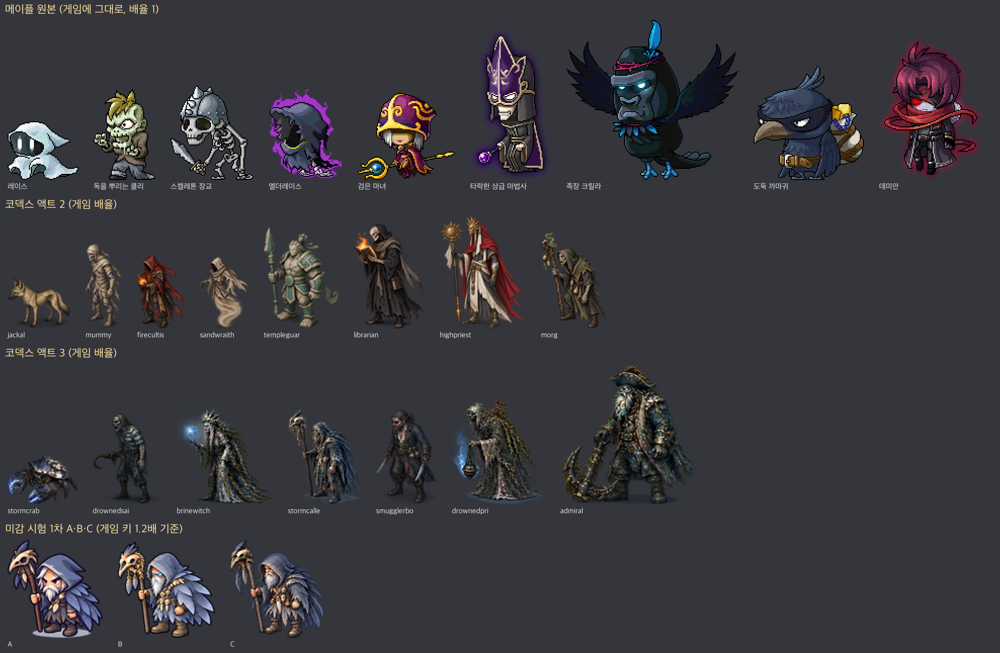

# 메이플 몬스터 그림 특징 분석 (2026-10-11, Claude)

목적: 액트 2·3 코덱스 그림이 메이플 에셋과 섞이지 않는 이유를 **실제 메이플 원본으로** 확인하고, 다음 그림 요청의 기준을 세운다.
방법:
- MSW 리소스 검색으로 메이플 몬스터 리소스 팩 113개를 모았다.
  - 초반 몹(버섯·슬라임·스텀프), 어두운 몹(레이스·쿨리 좀비·스켈레톤·타락한 마법사·검은 마녀), 해적·해군 유령, 보스(발록·자쿰·아카이럼·힐라·매그너스·데미안 등)를 포함한다.
- 각 팩의 stand 첫 프레임 원본 PNG를 받았다.
- 코덱스 액트 2 몬스터 16종, 액트 3 몬스터 12종, NPC 6종, 미감 시험 A·B·C를 같은 방식으로 쟀다.

자료 (`docs/art/maple-reference/`):
| 파일 | 내용 |
| --- | --- |
| `compare-ingame-scale.png` | **게임에 실제로 그려지는 크기**로 메이플 원본 / 액트 2 / 액트 3 / 1차 시안을 나란히 (2배 확대, 계단 유지) |
| `maple-dark-mobs-3x.png` | 어두운 메이플 몹 12종 3배 확대 — 선·명암·발광을 픽셀 단위로 본다 |
| `maple-mobs-overview-2x.png` | 모은 메이플 몹 전체 한눈에 |
| `maple-packs.csv` | 팩 id · stand 클립 · 첫 프레임 RUID · 크기 (게임에 바로 쓸 수 있다) |
| `metrics.json` | 그림마다 잰 값 |

참고: **액트 1 일반 몬스터는 이미 메이플 원본**이다 (굶주린 악령 = 메이플 「레이스」 stand `15e7b98c…`). 그래서 액트 1은 어울리고, 코덱스가 그린 액트 2·3만 따로 논다.

## 숫자로 본 차이 (중앙값)

| | 메이플 원본 (110) | 코덱스 액트 2 (16) | 코덱스 액트 3 (12) | 1차 시안 A·B·C |
| --- | ---: | ---: | ---: | ---: |
| 그림 키 (원본 px) | **109** (일반 몹 82~110, 보스 160~300) | 123 | 122 | 173~178 |
| 한 그림의 색 수 | **548** (사분위 336~1053) | 3,422 | 4,890 | 약 13,000 |
| 외곽선 밝기 (가장자리 픽셀 휘도) | **2** (거의 검은 선) | 43 | 44 | A 27 · B 5 · C 72 |
| 실루엣 가장자리 반투명 비율 | **0%** (딱 끊김) | 17% | 21% | 5~9% |
| 몸 안쪽 밝기 (휘도) | **97** | 84 | 55 | 68~97 |
| 채도 | **0.40** | 0.41 | 0.22 | 0.28~0.46 |

읽는 법:
- **색 수 6~9배:** 코덱스 그림은 사진처럼 미세한 그라데이션과 잡결로 칠해져 있다. 메이플은 한 덩어리에 몇 단계 색만 쓴다.
- **외곽선:** 메이플은 1px 짙은 외곽선이 실루엣을 딱 감싼다. 코덱스 그림은 선이 없이 흐려지고, 시안 B는 반대로 굵은 먹선이다.
- **반투명 가장자리:** 메이플 실루엣은 계단처럼 끊긴다. 반투명은 **발광(오라)에만** 쓴다 (몹의 44%가 오라를 가졌다). 코덱스는 몸 테두리 자체가 흐릿하다(AI 그림의 부드러운 경계).
- **밝기와 채도:** 액트 3은 몸이 어둡고(55) 채도가 낮다(0.22). 메이플의 어두운 몹도 몸은 중간 밝기이고, 「어둠」은 색과 발광으로 낸다.

## 눈으로 본 특징 (어두운 메이플 몹 기준)

`maple-dark-mobs-3x.png`: 레이스, 쿨리 좀비, 스켈레톤 장교, 해군 하사 유령, 검은 마녀, 타락한 상급 마법사, 데몬 가고일, 족장 크릴라, 엘더레이스, 아카이럼, 도둑 까마귀, 데미안.

1. **작게 그리고 그대로 쓴다.** 일반 몹 키 80~110px, 1픽셀 = 화면 1픽셀(배율 1)이다. 크게 그려서 줄이지 않는다. 그래서 아바타와 **픽셀 밀도가 같다.** 코덱스 그림은 크게 그린 뒤 0.8배 등으로 줄여 밀도가 다르다.
2. **1px 짙은 외곽선, 색이 들어간 선.** 검정 일색이 아니다. 갈색 몸은 짙은 갈색 선, 남색 망토는 짙은 남색 선을 쓴다. 뼈·흰 유령처럼 밝은 재질은 회색 선이다. 안쪽 선은 아주 적다.
3. **명암은 부드러운 그라데이션 2~3단 + 또렷한 하이라이트.**
   - 빛은 왼쪽 위에서 온다. 딱딱한 셀 명암(1차 B)도, 거친 유화 질감(코덱스)도 아니다.
   - 「매끈한 고무 같은 덩어리」에 가깝다(슬라임·레이스·까마귀).
4. **2~3등신, 머리·눈·손·무기를 크게.**
   - 사람형 몹도 머리가 키의 30~40%다 (검은 마녀, 데미안, 타락한 마법사, 쿨리 좀비).
   - 동물·괴물은 땅딸막하고 둥글다 (데몬 가고일, 크릴라).
5. **표정이 한 방이다.**
   - 섬뜩함은 몸의 해부학이 아니라 **눈**에서 나온다: 빛나는 눈(크릴라 청록, 데미안 빨강), 검은 얼굴 속 두 눈(레이스), 이를 드러낸 웃음(해군 유령), 눈 밑 그늘(도둑 까마귀).
   - 디테일보다 표정이 먼저다.
6. **「사악함」은 발광 오라로.** 엘더레이스·타락한 마법사는 보라, 아카이럼·데미안은 빨강의 반투명 후광이 실루엣 밖을 감싼다. 몸은 그대로 읽히고, 위험한 느낌은 오라 색이 준다.
7. **한 가지 아이디어와 소품 하나.**
   - 도둑 까마귀: 보물 자루를 짊어진 까마귀.
   - 해군 유령: 닻을 멘 이빨 웃음.
   - 크릴라: 고릴라 얼굴의 까마귀 족장.
   - 64px로 줄여도 그 아이디어가 읽힌다.
8. **어두워도 귀엽거나 우습다.** 메이플의 어두운 몹은 무서움 60, 우스움 40이다. 정색한 사실풍 공포(코덱스 액트 2·3)는 메이플에 없다.
9. **색:** 바탕색은 중간 밝기, 강조색 하나(보라·빨강·청록·금)를 세게 쓴다. 어두운 몹도 남색·보라·짙은 녹색처럼 「색이 있는 어둠」이다.

## 왜 「양산형 방치형」처럼 보였나

- **1차 시안:** 굵은 일정한 먹선, 딱딱한 3단 셀 명암, 모든 부위에 같은 밀도의 장식, 정면 대칭 자세, 약 13,000색의 매끈한 그라데이션. 모바일 방치형 RPG 일러스트의 전형이다. 메이플은 선이 얇고(1px, 색 있는 선), 명암이 부드럽고, 디테일이 적고, 표정에 힘을 몰아준다.
- **2차 목업:** 분위기는 좋지만 HD 도트풍 일러스트다(옥토패스류). 바닥·벽까지 잔결이 많고 화면 전체가 어둡다. 메이플 몹 옆에 두면 「다른 게임 스크린샷」이다.

## 앞으로의 그림 규칙 (초안 — 시험 뒤 `docs/art-style-guide.md`로 확정)

| 항목 | 규칙 |
| --- | --- |
| 크기 | **원본 크기로 그린다, 게임 배율 1.** 일반 몹 키 70~110px, 정예 110~150px, 보스 160~280px, NPC 70~100px (아바타 약 65~75px 기준) |
| 실루엣 가장자리 | 계단처럼 딱 끊김 (반투명 0). 반투명은 발광 오라·이펙트 레이어에만 |
| 외곽선 | 1px, 각 부위 고유색의 짙은 색. 밝은 재질은 회색 선. 안쪽 선은 최소 |
| 명암 | 빛은 왼쪽 위. 부드러운 2~3단 그라데이션 + 작은 하이라이트. 잡결·질감 붓 터치 금지 |
| 색 | 한 그림 300~1,000색. 몸 휘도 80~130, 채도 0.35 이상. 강조색 하나를 세게 |
| 비율 | 사람형 2~3등신, 머리·손·무기 크게. 동물·괴물은 땅딸막하고 둥글게 |
| 얼굴 | 표정이 읽혀야 한다. 빛나는 눈, 이빨 웃음, 찌푸린 눈썹. 섬뜩함은 눈으로 |
| 위험한 느낌 | 몸을 어둡게 칠하지 말고 실루엣 밖 발광 오라(보라·빨강·청백)로 |
| 아이디어 | 몬스터마다 64px에서 읽히는 아이디어 하나 + 소품 하나. 무서움 6 : 우스움 4 |
| 비교 기준 | 그릴 때마다 `maple-dark-mobs-3x.png`의 몹 옆에 놓고 같은 게임으로 보이는지 확인 |
