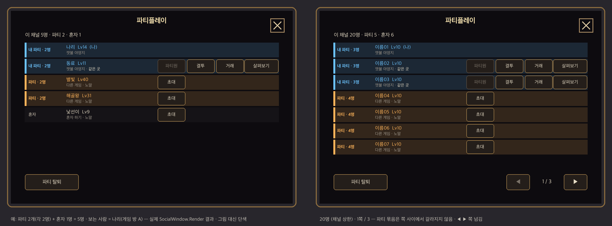

# 플레이어 창 — 같은 채널 전원 · 누구에게나 파티 · 파티 표시 (11-01)

사용자 요청 (요지): 플레이어 창에 같은 채널 사람은 전부 보여야 한다. 어제 팀원과 둘이 파티 중이었는데 낯선 사람 한 명이 혼자 하고 있었다. 그 사람에게도 파티를 걸 수 있어야 한다. 게시판은 공개 구인이고, 플레이어 창에서도 파티를 걸 수 있으면 좋겠다. 혼자 하는 사람도 파티를 안 받을 때만 혼자다. 이미 파티인 두 사람은 표시해 달라(글자색 통일 등). 한 채널에 파티 2개와 혼자 1명이 있으면 5명이 보이고, 파티 2개가 각 2명이라는 것을 알 수 있어야 한다. UI는 개발 판단에 맡겼다.



왼쪽은 사용자가 든 예다. 파티 2개(각 2명)와 혼자 1명, 모두 5명이다. 오른쪽은 채널 상한인 20명일 때의 1쪽이다. 두 그림 모두 실제 `SocialWindow.Render`가 만든 글·색·켜짐을 빌드된 `GameHUD` 배치 위에 그렸다. 게임 그림 대신 단색이고 글꼴은 맥 기본 글꼴이다. 다시 만드는 법은 `render_preview.py` 머리말에 있다.

## 1. 원인

결론: 예전 플레이어 창에는 같은 게임 방 사람만 보였다.

- 채널은 MSW 월드 인스턴스다. 그 안의 게임 방(인스턴스 방)마다 서버 문맥이 따로 돈다(docs/design/30 §3-1 메이커 실측).
- `PartySystem.RefreshRoster`는 `_UserService.UserEntities`로 목록(`Roster`)을 만들었다. 이 값에는 같은 방 사람만 들어 있다.
- 그래서 혼자 하기 방에 있는 낯선 사람이나 다른 게임 방의 파티는 목록에 없었다. 코드 주석은 「같은 채널의 모든 플레이어」였지만 실제 동작은 달랐다.
- 「파티」(`PlayerSocial.RequestAction`)와 「살펴보기」(`RequestInspect`)도 `GetUserEntityByUserId`를 쓴다. 이 역시 같은 방 사람만 찾는다.
- 품질 검사 `channel_roster` ①이 실제 본문으로 이 상황을 재현한다. 게임 방 A의 예전 목록에는 2명만 나왔다.

## 2. 설계 · 자료 흐름

```
[방마다 · 서버 PartySystem]  2초마다 RefreshRoster
    → MaybeWriteChannel (ChannelWriteDue: 사람·파티 3초 / 레벨·이름만 180초 모아 / 그대로 300초 / 실패 30초 쉼)
    → 채널 공유 메모리 _RoomService:GetSharedMemory("ChannelRosterV1") 변수 "roster" 의 자기 칸만 고쳐 쓰기
      (Get + UpdateVariableAndWait(ETag) · 충돌이면 다시 읽어 3번까지 · 사람이 0이면 칸 지움 · 쓸 때 오래된 칸 정리)

[플레이어 창 열림 · 클라이언트 SocialWindow]  열 때 RequestChannel(force) → 처음 1분 8초 · 그 뒤 20초마다 (단추를 누르면 다시 8초)
    → [그 사람 방 서버] ReadChannel (7초 모아 · 열 때는 2초보다 오래된 값이면 새로)
      + 이 방은 지금 값(UserEntities) → ChannelEntries (오래된 칸 600초 · 없어진 방(InstanceRooms) · 두 칸 중복 정리)
      → ChannelRowsFor (보는 사람마다 관계·위치·파티 단추 판단) → ShowChannel(그 사람에게만 · 바뀌었을 때만)
    → BuildView (파티 묶기·색) → Paginate (8줄 · 묶음 안 갈라짐) → Render

[초대 · 다른 방]  「초대」 → TownBoard.RequestChannelInvite (같은 규칙 재확인 · 같은 상대 20초)
    → _RoomService:RequestSendEventToRoomAsync(ChannelInviteEvent{invite}, 받는 사람 방 키)
    → [받는 방 TownBoard.OnChannelEvent] 받은 요청 창(PlayerSocial Pending kind "game" — 게시판 초대와 같은 길 DeliverInvite)
    → 수락: AnswerInvite (게임 방 = RoomReturnV1 + 로비 → OnLobbyReady가 넣음 · 로비 = RoomSystem.Forget → Enter 바로)
    → 결과(ok·no·busy·gone·full·locked·cant)를 ChannelInviteEvent{reply}로 초대한 사람의 방에 → 알림
```

공유 메모리 키

| 이름 | 범위 | 변수 | 값 |
|---|---|---|---|
| `ChannelRosterV1` | `_RoomService`: 같은 월드 인스턴스(채널)의 방들 | `roster` | `{"v":1,"rooms":{"<방 키>":{"t":쓴 시각 ms,"k":"game/lobby/depth/charsel","p":[{"u":userId,"n":이름,"l":레벨,"m":연 최고 난이도,"d":지금 난이도,"y":그 방 파티 번호}]}}}` |

- 크기: 20명이면 약 2KB다. 변수 하나의 상한은 80,000바이트다.
- 파티 키: `방 키#파티 번호`. 방마다 PartySystem이 따로 돌기 때문에 방 키를 붙여 구분한다.
- 정리:
  - 600초 넘게 소식이 없는 칸은 지운다.
  - `_RoomService.InstanceRooms`에 없는 방의 칸은 30초 유예 뒤 지운다. 단, 내 방이 그 목록에 있을 때만 그 목록을 믿는다. 내 방이 없으면 시간 기준만 쓴다.
  - 한 사람이 두 칸에 있으면(방을 옮기는 중) 새 칸을 쓴다.
- 방 사이 초대에는 공유 메모리를 쓰지 않는다. 받는 방은 게시판을 읽지 않기 때문이다. 모든 방이 초대를 확인하려고 4초마다 읽으면 한 방에 분당 15번이다. 채널 하나에 11방이면 165번, 채널 5개면 825번(82%)이 되어 한도를 넘는다. 그래서 RoomService 방 사이 이벤트로 받는 방에 바로 보낸다. 공식 문서 「Communicating Between Rooms using RoomService」의 방식이다.

## 3. 공유 메모리 호출 수 (월드 전체 분당 1000번 한도)

계산 방법: 실제 `PartySystem` 본문을 한 채널(20명)에서 12분 돌리고 마지막 10분의 호출을 셌다(`tests/quality/channel_roster.lua` ⑧, 결과 `budget.json`). 쓰기는 Get+Update 2번, 읽기는 Get 1번이다.

| 경우 | 채널 하나 (호출/분) | 채널 5개 (100명) | 채널 10개 (200명) |
|---|---|---|---|
| 보통: 로비 2 · 파티 방 4·3·2·2 · 혼자 하기 6 · 심연 1 (12방) · 레벨 4분에 1 · 방마다 10분에 1명 들락 · 창 연 방 1 | **12.0** | 60 (**6%**) | 120 (12%) |
| 많음: 20명 모두 혼자 하기 (20방) · 레벨 1분에 1 · 5분에 1명 들락 · 창 연 방 6 (30%) | **35.1** | 176 (**18%**) | 351 (35%) |
| 극단: 위 + 20방 모두 창을 내내 열어 둠 | **74.7** | 373 (37%) | 747 (75%) |

호출 수를 줄이려고 처음 안에서 값을 바꿨다.

| 값 | 처음 안 | 지금 |
|---|---|---|
| 묻기 간격 | 6초 | 처음 1분 8초 · 그 뒤 20초 |
| 모아 읽기 | 5초 | 7초 |
| 레벨 모아 쓰기 | 60초 | 180초 |

처음 안은 같은 시험에서 보통 21.1 · 많음 88.8 · 극단 221.3이었다. 지금 값으로 2.5~3배 줄었다.

- 이 한도는 기존 공유 메모리 사용과 함께 쓴다. 기존 사용은 RoomSystem 방 목록(`GameRoomsV1`, 월드 공유 메모리)과 마을 게시판(`TownBoardV1`)이다.
- 지금 값이면 보통 채널 10개(200명)에서 12%다.
- 극단 경우는 모든 사람이 창을 계속 띄워 둔 상황이다. 창을 열고 1분이 지나면 20초마다 묻기 때문에 이 이상은 늘지 않는다.

## 4. 초대 규칙 (같은 방 = 기존 파티 초대 · 다른 방 = 내 게임에 초대)

| 경우 | 플레이어 창 「파티」 단추 · 둘째 줄 | 서버가 막을 때 안내 (보낸 사람) |
|---|---|---|
| 나 | 없음 | — |
| 같은 방 · 같은 파티 | 「파티원」 흐리게 · 못 누름 | 이미 같은 파티입니다 |
| 같은 방 · 다른 사람 | 「파티」 | (기존) 상대가 다른 요청을 처리 중입니다 |
| 다른 방 · 들어올 수 있음 (게임 방·로비) | 「초대」 | 보냄: {이름}님에게 초대를 보냈습니다 |
| 내가 게임 밖 (로비·심연) | 「초대」 흐리게 · 「게임 안에서만 초대 가능」 | 게임 안에서만 초대할 수 있습니다 |
| 내가 쓰러짐 | 「초대」 흐리게 · 「쓰러진 상태」 | 쓰러진 상태에서는 초대할 수 없습니다 |
| 상대가 심연·캐릭터 선택 | 「초대」 흐리게 · 「이동 불가」 | 심연이나 캐릭터 선택 중인 플레이어는 초대할 수 없습니다 |
| 내 게임 가득 (4명) | 「초대」 흐리게 · 「내 게임 인원 가득」 | 이 게임은 이미 가득 찼습니다 (게시판과 같은 글) |
| 상대가 내 난이도를 안 열었음 | 「초대」 흐리게 · 「악몽 미개방」 | 그 사람은 아직 악몽 난이도를 열지 않았습니다 (게시판과 같은 글) |
| 같은 상대 20초 안 다시 (파티·결투·거래 모두) | — | 같은 플레이어에게는 N초 뒤에 다시 보낼 수 있습니다 |
| 1초 안 연타 | — | (무시) |
| 목록이 낡아 그 사람을 못 찾음 | — | 그 플레이어를 찾지 못했습니다. 목록을 다시 확인해주세요 |

받는 사람 쪽 (받은 요청 띠: 10-29 확정 글귀 「{이름}님으로부터 초대 - 수락 시 이동합니다」 그대로)

| 경우 | 받는 사람 | 초대한 사람에게 돌아가는 알림 |
|---|---|---|
| 거절 (또는 20초 무응답) | 그대로 혼자(지금 방) | 거절: {이름}님이 거절했습니다 · 무응답: 없음 |
| 수락 · 게임 방에 있음 | 로비를 거쳐 초대한 방으로 (게시판 초대와 같은 순서) | {이름}님이 초대를 수락했습니다 |
| 수락 · 로비에 있음 | 모집·대기를 지우고 바로 그 방으로 (`RoomSystem.Enter`) | {이름}님이 초대를 수락했습니다 |
| 다른 요청 처리 중 | (요청 안 옴) | 상대가 다른 요청을 처리 중입니다 |
| 그 방에 이제 없음 | — | 그 플레이어를 찾지 못했습니다. 목록을 다시 확인해주세요 |
| 수락했는데 초대한 방이 가득 | 이 게임은 이미 가득 찼습니다 | 게임 인원이 가득 차 {이름}님이 들어오지 못했습니다 |
| 수락했는데 난이도 미개방 | (기존) 아직 열지 않은 난이도의 게임입니다 | {이름}님은 아직 이 난이도를 열지 않았습니다 |
| 수락했는데 쓰러짐·심연 등 | (기존) 지금은 다른 게임으로 옮길 수 없습니다 | {이름}님은 지금 이동할 수 없습니다 |
| 초대한 방이 없어짐 (목록을 믿을 수 있을 때) | 초대한 게임이 이제 없습니다 | — |

- 게시판(공개 구인)은 그대로다. 게시판 초대도 이제 거절·수락 결과를 초대한 사람에게 돌려준다(`fr` 방 키 추가).
- 수락할 때, 「파티 찾는 중」이었던 사람만 게시판에서 지운다. 예전에는 수락할 때마다 게시판을 고쳐 썼다(2번 호출).
- 결투·거래·살펴보기는 같은 방에서만 된다(서버 조건 그대로). 다른 방 줄에서는 이 단추를 숨긴다.

## 5. UI 판단과 근거

- **창** 1040×714, 예전 800×660이다. 「파티 · N명」 칸이 새로 들어갔다. 이름 칸은 두 줄이다(첫 줄 이름·레벨, 둘째 줄 위치와 못 하는 이유). 모든 값은 `ui-tokens.cjs` `SOCIAL`에서 온다. 좁은 화면 상한 1368 안이다.
- **20명 · 8줄 × 쪽 넘김 (◀ 1 / 3 ▶)**: 메이커 실측상 엔진 스크롤 칸은 휠에 반응하지 않는다. 그래서 PC 휠에 기대지 않는다. 파티 묶음(최대 4명)은 쪽 사이에서 갈라지지 않는다. 쪽이 2개 이상일 때만 넘김 단추를 보인다.
- **파티 표시는 네 겹이다.** 같은 파티는 같은 글자색이다. 같은 색 띠(왼쪽 6px)와 줄 바탕(색 16%)을 깔고, 「파티 · N명」을 붙여 쓴다. 파티원끼리는 붙어 있다. 색만 쓰면 색약 사용자가 구분하기 어렵다. 그래서 글자 표시와 붙여 쓰기를 함께 쓴다.
- **내 파티가 맨 위**다. 나도 목록에 넣는다(「(나)」). 그래야 「내 파티 · 2명」이 실제 인원과 맞는다. 내가 혼자면 내 줄이 맨 위다.
- 그다음 순서는 다음과 같다.
  - 다른 파티: 같은 방 → 큰 파티 → 이름 순
  - 혼자: 같은 방 → 이름 순
- **색** `PARTY.colors`: 하늘 #6CC4FF(내 파티) · 호박 #FFB45A · 분홍 #FF8CC6 · 라벤더 #B9A2FF · 청록 #5EDBC4 · 연두 #B6E35A. 다른 파티는 둘째 색부터 차례로 돈다. 이웃한 묶음끼리는 색이 다르다.
  - 대비: 창 바탕과 자기 색이 깔린 줄 바탕 위에서 최소 6.95다(기준 4.5).
  - 색 차이: 색끼리, 그리고 혼자 기본색 #E6DCC6·흐린 글자색과 ΔE가 최소 38이다(기준 30).
  - 예전 「같은 곳」 초록과 헷갈리지 않게 초록 계열은 뺐다. 「같은 곳」은 밝은 기본색으로 바꿨다.
- **맨 위 요약 한 줄**: 「이 채널 5명 · 파티 2 · 혼자 1」. 사용자가 든 예를 한눈에 확인하게 한다.
- **단추 이름**: 같은 방은 「파티」, 다른 방은 「초대」다. 다른 방 사람은 수락하면 내 게임으로 옮겨 오기 때문에 이름을 다르게 했다. 받는 쪽 띠도 「초대 - 수락 시 이동합니다」다.
- **위치 글**:
  - 같은 방: 맵 이름 · 같은 곳
  - 다른 방: 로비 / 혼자 하기 · 노말 / 다른 게임 · 악몽 / 심연 N층 / 캐릭터 선택
  - 「심도」는 다른 화면에 맞춰 「심연」으로 바꿨다.
- **받은 요청 띠**(`ConfirmHUD/SafeArea/Request`)는 구조도 글도 그대로다. 다른 방 초대는 기존 kind `game` 글을 쓴다. **ConfirmHUD 구조는 바꾸지 않았다.**
- 줄 단추 높이 54px는 예전과 같다(모바일 터치 88 권장보다 작다 · ui_lint L007 경고는 예전에도 있었다).

## 6. 글귀 (새로 생긴 것 · 시스템 안내 -습니다/-해주세요 · UI는 짧게)

- 창:
  - 요약: 이 채널 N명 · 파티 P · 혼자 S
  - 불러오는 중… · 다른 게임 목록을 불러오지 못했습니다
  - 태그: 내 파티 · N명 / 파티 · N명 / 혼자
  - 단추: 파티원 · 초대
  - 둘째 줄: 게임 안에서만 초대 가능 · 쓰러진 상태 · 이동 불가 · 내 게임 인원 가득 · {난이도} 미개방 · 로비 · 혼자 하기 · 다른 게임 · 캐릭터 선택 · 심연 N층
- 알림: 4장 표의 서버 안내·돌아가는 알림 열 그대로다. 품질 검사가 「니다/해주세요」로 끝나는지 확인한다.

## 7. 검사

- `npm test`: 21/21 통과. 「알림 채널 배정」 표는 `node tools/notice_channels.cjs`로 다시 만들었다(152곳, 새 알림은 모두 B).
- `python3 tests/quality/run.py --lua /private/tmp/lua-5.4.8/src/lua`: 30그룹 모두 통과(종료 0). 새 그룹 `channel_roster`는 200 checks다.
- `node tools/check_scripts.cjs`: 스크립트 146개, 문제 0.
- `node tools/check_mobile_layout.cjs`(npm test 안): 문제 0.
- ui_lint `GameHUD`: 오류 0.
  - SocialWin 경고 36은 모두 L007(줄 단추 54px · ◀▶ 62px)이다. 예전에도 같은 종류 34개가 있었다.
  - L023(요약 줄과 닫기 단추 겹침)은 고쳤다.
- mLua LSP 진단: 바뀐 스크립트 5개 오류 0.

## 8. 메이커 확인 절차 (부모 · 메이커 담당)

1. 메이커를 멈춘 상태에서 시작한다.
   1. Refresh를 2번 한다. 새 스크립트 `Social/ChannelInviteEvent.mlua`의 `.codeblock`이 생긴다.
   2. 빌드 로그를 확인한다. `LEA-1118 ChannelInviteEvent`가 나오면 `TownBoard.mlua`를 touch하고 Refresh를 한 번 더 한다.
2. 채널 하나에 방 여러 개를 만든다. 메이커는 월드 인스턴스(= 채널)가 하나이므로 클라이언트 여러 개만 있으면 된다.
   - 메이커 다중 클라이언트 플레이(플레이어 수 3) 기준:
     - 클라이언트 1 → 캐릭터 → 「혼자 하기」(방 `game:s…`)
     - 클라이언트 2 → 「방 만들기」 → 출발(방 `game:…`)
     - 클라이언트 3 → 로비에 남는다
   - 서버 문맥은 `maker_get_context_keys`로 본다: `server_main`(로비) · `server_instance_game:…`.
   - 클라이언트를 하나만 띄울 수 있으면 대체 방법을 쓴다. `server_main`(로비) 문맥에서 아래 스크립트로 다른 방 칸을 넣는다. 그 뒤 **30초 안에** 혼자 하기 방에서 P를 연다. 가짜 방은 InstanceRooms에 없어서 30초 유예 뒤 빠진다. 가짜 방으로 초대하면 「초대를 보내지 못했습니다. 다시 시도해주세요」가 나와야 한다(방 없음).
     ```lua
     local code, mem = _RoomService:GetSharedMemory("ChannelRosterV1")
     local r = mem:GetVariableAndWait("roster")
     local data = (r.Code == 0 and r.Info ~= nil) and _HttpService:JSONDecode(r.Info.Value) or { v = 1 }
     if data.rooms == nil then data.rooms = {} end
     local t = DateTime.UtcNow.Elapsed
     data.rooms["game:fake1"] = { t = t, k = "game", p = { { u = "fakeA", n = "가짜파티1", l = 20, m = 1, d = 0, y = 1 }, { u = "fakeB", n = "가짜파티2", l = 22, m = 1, d = 0, y = 1 } } }
     data.rooms["game:sfake2"] = { t = t, k = "game", p = { { u = "fakeC", n = "가짜혼자", l = 9, m = 0, d = 0, y = 0 } } }
     mem:SetVariableAndWait("roster", _HttpService:JSONEncode(data))
     log("[VRF] fake channel rooms written")
     ```
3. 기대 [VRF] (`maker_logs` normal):
   1. 방마다 `[VRF] channel roster on room=<방 키> memory=ChannelRosterV1`
   2. 사람이 들어오면 `[VRF] channel write room=game:s… n=1 why=urgent ok=true calls=2`
   3. 클라이언트 1에서 P → `[VRF] channel rows viewer=<uid> n=3 ok=true calls=…`, `[VRF] social render n=3 parties=… solo=… page=1/1 got=true`
   4. 「초대」(클라이언트 2의 사람에게) → 보낸 방에 `[VRF] channel invite <보낸> → <받는> room=game:… sent=true`, 받은 방(`server_instance_game:…`)에 `[VRF] channel invite recv to=… result=delivered`
   5. 받는 쪽 띠 「{이름}님으로부터 초대 - 수락 시 이동합니다」 → 거절 → `[VRF] channel invite answer uid=… accept=false` → 보낸 방에 `[VRF] channel invite reply to=… code=no` · 알림 「…님이 거절했습니다」
   6. 같은 상대에게 바로 다시 → `[VRF] invite cooldown kind=party … left=…`
   7. 20초 뒤 다시 → 수락 → `[VRF] board invite accept uid=… → <id> moved=1` → 로비를 거쳐 `[VRF] room return → <id>` → 그 방에서 `[VRF] auto party join …` (게임 방 자동 파티)
   8. 로비(클라이언트 3)에 초대 → 수락 → `[VRF] channel invite accept from lobby uid=… entered=true`
4. 화면 확인 (P 창):
   - 요약 줄
   - 내 파티 맨 위 하늘색
   - 다른 파티 호박색, 붙어 있는지
   - 혼자는 기본색 「혼자」
   - 다른 방 줄에 결투·거래·살펴보기가 없는지
   - 20명이 아니면 ◀ ▶ 숨김
   - 실제 글꼴에서 「내 파티 · 4명」이 태그 칸(132px)에 한 줄로 드는지 (BestFit 최소 12)
5. 공유 메모리 호출: P를 1분 넘게 띄워 두고 `[VRF] channel rows`의 `calls=` 증가를 본다. 처음 1분은 8초에 1번이고 그 뒤 20초에 1번이어야 한다(바뀐 게 없으면 rows 로그 대신 `calls`만 늘어난다).

## 9. 위험 · 남은 확인

- **방 사이 이벤트(`RequestSendEventToRoomAsync`)는 이 프로젝트에서 처음 쓴다.** 메이커·출시 환경에서 전달을 확인해야 한다.
  - 실패하면 보낸 사람에게 「초대를 보내지 못했습니다. 다시 시도해주세요」가 뜬다. 조용히 사라지지 않는다.
  - 방 사이 이벤트의 한도는 문서에 없다. 월드 인스턴스 사이 이벤트는 분당 1000이다. 초대는 같은 상대 20초·1초 연타 막기로 묶여 있다.
- **RoomSharedMemory 한도**: 문서에 명시된 한도는 WorldInstanceSharedMemory 분당 1000뿐이다. 같은 한도로 보고 계산했다.
- **InstanceRooms가 다른 방에서도 같은 목록인지 확인하지 못했다.** 내 방이 목록에 없으면 목록을 안 믿고 시간(600초)으로만 정리한다. 이 경우 닫힌 방 사람이 최대 10분 보일 수 있다. 그 사람을 초대하면 「그 플레이어를 찾지 못했습니다」가 뜬다.
- 다른 방 사람의 레벨은 최대 180초 늦게 보인다(호출 수 때문). 같은 방은 늘 지금 값이다.
- 로비 사람의 수락은 `RoomSystem.Enter`를 TownBoard에서 바로 부른다. 방 목록 「들어가기」와 같은 함수지만, 이 경로 자체는 메이커에서 확인해야 한다.
- 같은 상대 20초 쿨다운이 결투·거래 요청에도 걸린다(연타·도배 막기).
- 같은 파티에 다시 파티 초대하면 이제 거절한다. 예전에는 파티를 풀고 다시 만들었다.
- `GameHUD`는 작업트리에 커밋된 빌더로 만들었다(SocialWin 밖 변화 0). 원본 체크아웃의 커밋 안 된 새 빌더로 만들면 FaceDilate·UITouchReceive 소음이 생긴다. 통합 때 부모가 다시 만든다.
- 다른 작업자와 겹칠 수 있는 파일:
  - `tests/quality/run.py` 그룹 목록과 `tests/quality/README.md`
  - `tools/build/ui-tokens.cjs`: 끝에 `module.exports.PARTY/SOCIAL`만 덧붙였다(RankWin 쪽 RANKTAB은 안 건드림).
  - `docs/evidence/2026-10-31-playfeedback-B/notice-channels.md`: 생성물이다. `node tools/notice_channels.cjs`를 다시 돌리면 된다.

## 파일

- `export_layout.cjs`: 빌드된 SocialWin 배치를 `layout.json`으로 뽑는다(UIBuilder로 읽음).
- `five.json` · `twenty.json`: 품질 검사가 실제 Render로 만든 화면 값이다(`CHANNEL_PREVIEW_OUT`).
- `render_preview.py`: `preview-five.png` · `preview-twenty.png` · `offline-preview.png`를 만든다.
- `budget.json`: 호출 수 계산 결과다(`CHANNEL_BUDGET_OUT`).
