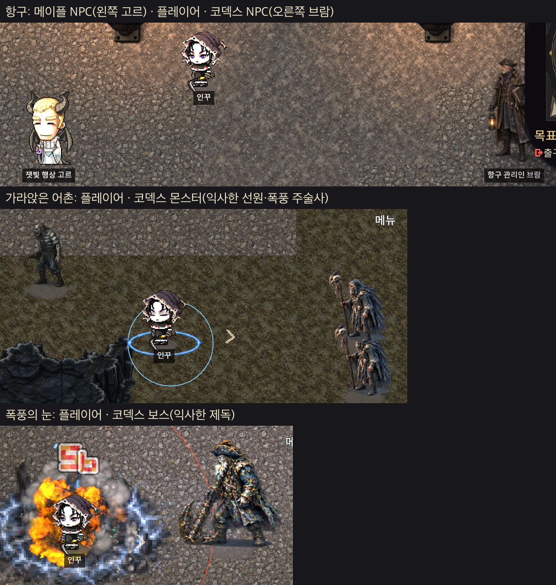

# Codex 요청 — 미감 시험: 「폭풍 주술사」 3가지 버전 (2026-10-11, Claude)

액트 2·3 몬스터·NPC를 다시 그리기 **전에** 그림체부터 정한다. 같은 몬스터 하나를 세 가지 그림체로 그려서 사용자가 하나를 고르고, 고른 그림체로 나머지를 다시 그린다.
**이번 요청은 시험 그림만 그린다. 기존 그림·RUID·데이터는 건드리지 않는다.**

## 왜 다시 정하나

- **플레이어와 메이플 NPC**(위 사진 왼쪽 「잿빛 행상 고르」, 가운데 플레이어)는 메이플 그림이다.
  - 2~2.5등신이고 머리와 얼굴이 크다.
  - 진한 외곽선과 2~3단 셀 명암을 쓰고, 덩어리가 단순하다.
- **코덱스 액트 2·3 그림**(위 사진 오른쪽 「브람」, 선원, 주술사, 제독)은 다르다.
  - 7~8등신의 사실 비율이다.
  - 외곽선이 없는 유화풍 명암에 깃털·천 결을 아주 잘게 그렸다.
  - 바닥과 비슷한 탁한 명도다.
- 그래서 한 화면에서 **서로 다른 게임처럼** 보인다. 팀 피드백은 「누구는 2등신, 누구는 8등신」이었다. 사용자 평은 「디아블로를 쫓다가 메이플도 디아블로도 아닌 미르·리니지 같은 그림이 됐다」이다.
- 액트 2 안에서도 비율이 갈린다. 문지기 형제는 3등신에 가깝고, 대사제·서고 사서는 7~8등신이다.

**유지할 것:**
- 게임의 어두운 고딕 판타지 분위기와 액트별 팔레트(액트 3 = 젖은 검푸른색·소금 흰빛·번개 청백).
- 탑다운(위에서 비스듬히) 시점과 왼쪽을 보는 방향.

**바꿀 것:** 비율, 선, 명암, 결의 양. 이 넷이 메이플과 한 세계로 보이게 바꾼다.

## 시험 대상

**폭풍 주술사** (`stormcaller`, 액트 3 일반 몬스터)
- 번개 절벽·가라앉은 어촌·밀수꾼 동굴·폭풍 등대에 나온다.
- 번개 연쇄를 쓴다.
- 보스가 아니다.

| 항목 | 내용 |
| --- | --- |
| 지금 그림 | `assets/codex-act3-v1/previews/stormcaller-states.png` (사용자가 보낸 그림), 프레임 `png/monsters/stormcaller/` |
| 캐릭터 | 깃털 망토를 쓴 늙은 해안 주술사. 새 해골을 단 지팡이를 들었고, 공격 때 지팡이 끝에 번개가 맺힌다 |
| 지킬 것 | 깃털 망토 · 새 해골 지팡이 · 수염 · 번개 청백 포인트. 세 버전 모두 **같은 캐릭터로 알아볼 수 있어야** 한다 |

## 세 가지 버전

| | **A. 메이플 정통** | **B. 메이플 다크** (Claude 추천) | **C. 디아블로 치비** |
| --- | --- | --- | --- |
| 한 줄 | 메이플 일반 몬스터처럼. 어두움은 색으로만 낸다 | 메이플의 몸 비율·선·셀 명암에 우리 게임의 어두운 색과 빛을 입힌다 | 지금 그림의 칠과 분위기는 두고 비율과 결만 줄인다 |
| 등신 (키 ÷ 머리) | **2~2.5** | **3~3.5** | **4** |
| 머리·손·무기 | 크게 과장 (머리가 키의 40%) | 조금 과장 (머리 30%, 지팡이 머리 크게) | 거의 실제 비율 (머리 25%) |
| 외곽선 | 진한 단색 선 2px (`#1A1420` 근처), 굵기 일정 | 짙은 고유색 선 1.5~2px (망토는 짙은 남색, 피부는 짙은 갈색) | 선 없음, 대신 왼쪽 위 테두리 빛 1px |
| 명암 | 2단 셀 (밝은 면 / 어두운 면) + 하이라이트 한 점 | 3단 셀 + 아주 약한 그라데이션, 지팡이 번개만 발광 | 지금 같은 칠 |
| 결 (깃털·천) | 큰 덩어리 5~7개, 결 선 없음 | 큰 덩어리 + 끝에만 결 선 몇 줄 | 지금 결의 절반 정도 |
| 명도·채도 | 메이플 수준으로 밝게, 폭풍 청색 포인트 | 몸 휘도 평균 **80~120** (지금 35~64), 채도 중간, 눈·번개는 청백으로 빛남 | 지금 팔레트에 명도만 +20~30 |
| 얼굴 | 큰 눈, 표정이 읽힘 (화난 눈썹) | 두건 그림자 속에서 빛나는 두 눈 | 지금처럼 수염과 그림자 |
| 비슷한 느낌 | 메이플 필드 몬스터 (주니어 발록, 다크 스텀프 등) | 메이플 후반 지역 몬스터 (아케인리버·그란디스, 검은 마법사 군단 쪽 어두운 몬스터) | 지금 그림의 비율만 줄인 것 |
| 바꾸는 양 | 가장 큼 (액트 1~3 어두운 분위기와 거리가 생길 수 있음) | 중간 | 가장 작음 (메이플과의 거리가 남을 수 있음) |

**세 버전 공통 규칙**
- 시점은 탑다운(위에서 비스듬히), 왼쪽을 본다. 배경은 투명이고 발밑 아래 여백은 3px로 지금과 같다.
- 빛은 왼쪽 위에서 온다. 발밑 그림자는 지금처럼 옅은 타원이다.
- **64px로 줄여도 실루엣**(지팡이·망토·두건)이 읽혀야 한다.
- 화면 크기는 플레이어 캐릭터 키를 기준으로 맞춘다:

  | 종류 | 플레이어 키 대비 |
  | --- | --- |
  | 일반 인간형 몬스터 | 1.1~1.3배 |
  | 정예 | 1.4배 |
  | 보스 | 1.8~2.2배 |
  | NPC | 1.0~1.2배 |

  플레이어 키는 위 비교 사진의 가운데 캐릭터다. 지금은 NPC 브람이 플레이어의 약 1.5배라 크고, 보스 제독은 약 1.6배라 보스치고 존재감이 약하다. 비율을 바꾸면 이 크기 기준도 함께 맞춘다.

## 그릴 것

버전마다 **같은 5장**을 그린다. 움직임이 그 그림체에서 어떻게 보이는지 고를 수 있게 상태마다 대표 한 장씩이다.

| 상태 | 장면 |
| --- | --- |
| stand | 서 있기 |
| move | 걷기 중 발을 크게 뗀 장면 |
| attack | 지팡이에 번개가 맺힌 순간 |
| hit | 맞아서 움찔 |
| die | 쓰러진 마지막 장면 |

**함께 그리면 좋은 것 (권장):** 같은 그림체가 보스와 NPC에도 통하는지 보려고 버전마다 stand 한 장씩 더 그린다.
- 익사한 제독 바렌 (`admiral`, 보스)
- 항구 관리인 브람 (`harbormaster`, NPC)

**비교 시트 (필수)** — 사용자가 이것만 보고 고를 수 있게:

1. `style-lineup.png`
   - 가로로 지금 그림 → A → B → C의 stand를 놓는다.
   - 각 칸 옆에 플레이어 캐릭터를 같은 화면 비율로 세운다. `docs/requests/style-trial/ingame-compare.png`에서 잘라 써도 된다.
   - 칸 위에 등신 수와 몸 휘도 평균을 적는다.
2. `style-ingame-A.png` / `-B.png` / `-C.png`
   - 액트 3 바닥 위에 플레이어 1명과 그 버전의 주술사 3마리(+제독·브람)를 게임 화면 크기로 놓는다.
   - 게임 어둠(밝기 0.32 정도)을 씌운 모습으로 만든다. 실제 화면에서 어떻게 보일지 판단하는 용도다.
3. `style-states-A.png` / `-B.png` / `-C.png`: 버전별 5상태를 한 줄로 놓는다.

## 납품

- 위치: `assets/codex-style-trial-v1/`
  - `png/A/`, `png/B/`, `png/C/`: 파일명 `stormcaller-<상태>.png`, `admiral-stand.png`, `harbormaster-stand.png`
  - `previews/`: 위 비교 시트
- **업로드·RUID 등록 하지 않는다.** 고르기 전 시험이라 게임에 넣지 않는다.
- 처리 결과: `docs/requests/codex-style-trial-delivery-YYYYMMDD.md`
  - 버전마다 등신·외곽선 굵기·몸 휘도를 실제로 잰 값.
  - 그리면서 어려웠던 점. 예: A에서 어두운 분위기를 내기 어려웠던 부분.

## 고른 다음 (참고)

1. 사용자가 A·B·C 중 하나를 고르거나 섞는다 (예: B 비율 + A 외곽선).
2. Claude가 고른 그림체를 `docs/art-style-guide.md`로 정리한다. 등신·선·명암·명도·크기 표, 몬스터·보스·NPC·장식별 규칙을 담는다.
3. 그 가이드로 액트 2·3 몬스터·NPC를 다시 그린다. 순서와 범위는 그때 따로 요청한다.
   - 지금 받아 둔 액트 3 바닥 밝기 수정·갈매기 요청([codex-act3-fix-20261011](codex-act3-fix-20261011.md))은 그대로 진행한다.
   - 갈매기는 고른 그림체로 그리도록 그때 맞춘다.
